#  File Beholder

A fully portable file manager for Windows and Windows PE, built with Rust and Iced. Browse up to four panels, recover older files from shadow copies, and manage transfers through a shared ribbon and queue.

[](https://github.com/SkylerWallace/file-beholder/releases/latest/download/file-beholder.exe)

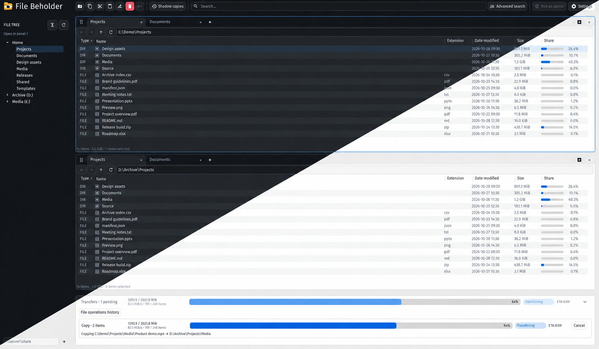

<details>
<summary>More screenshots</summary>

<details>
<summary>Default — dark and light</summary>

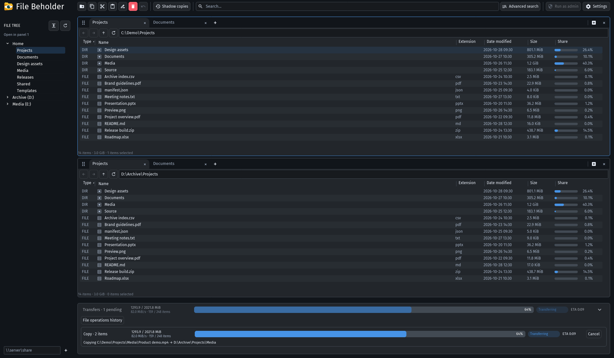

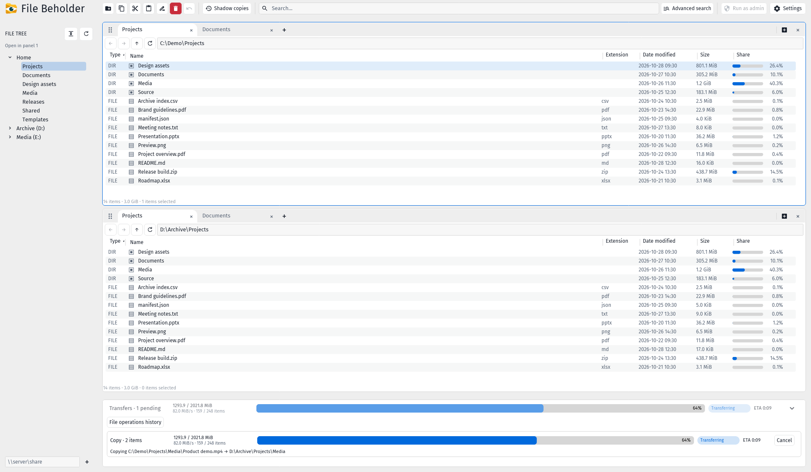

</details>

<details>
<summary>Neumorphic — dark and light</summary>

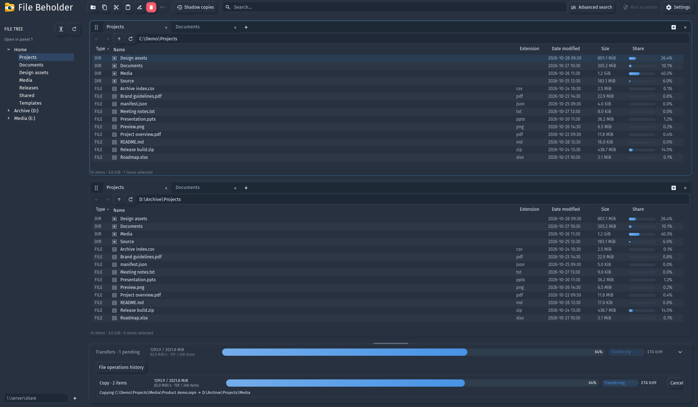

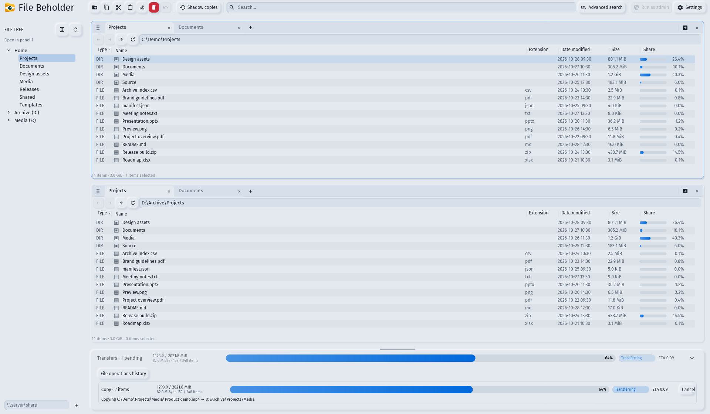

</details>

<details>
<summary>Material — dark and light</summary>

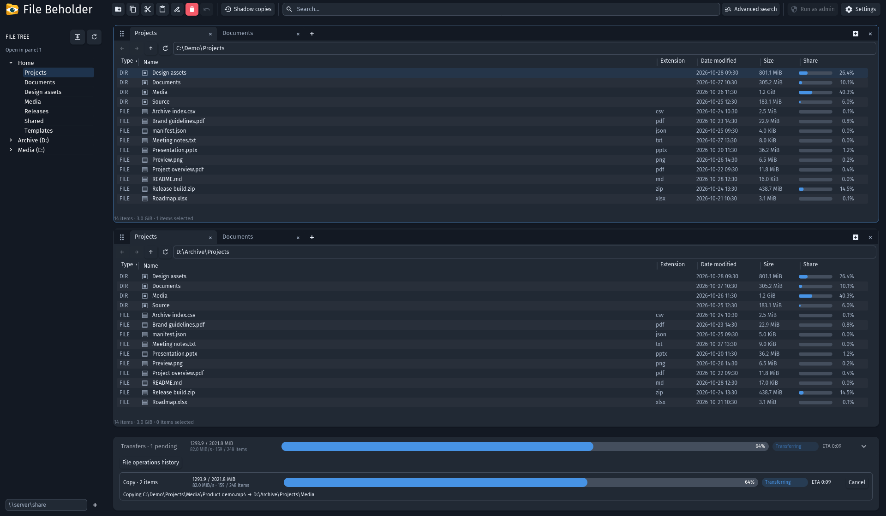

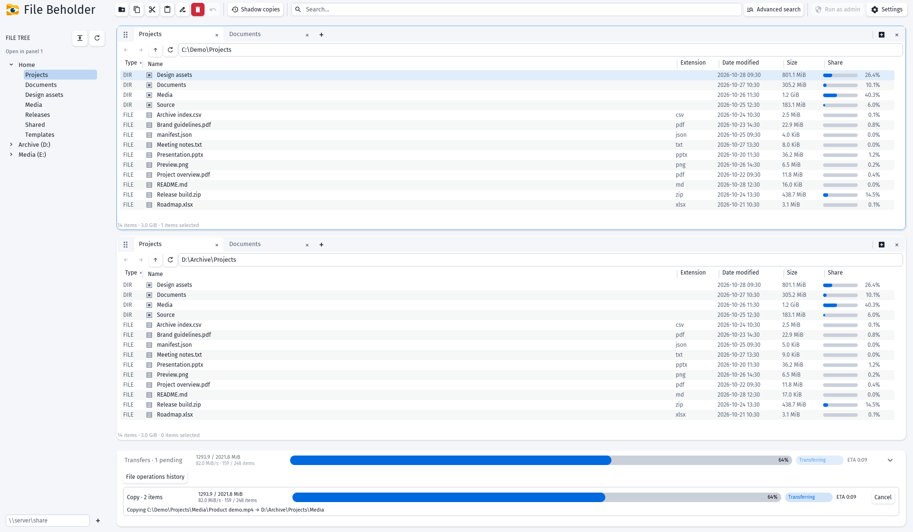

</details>

<details>
<summary>Metro — dark and light</summary>

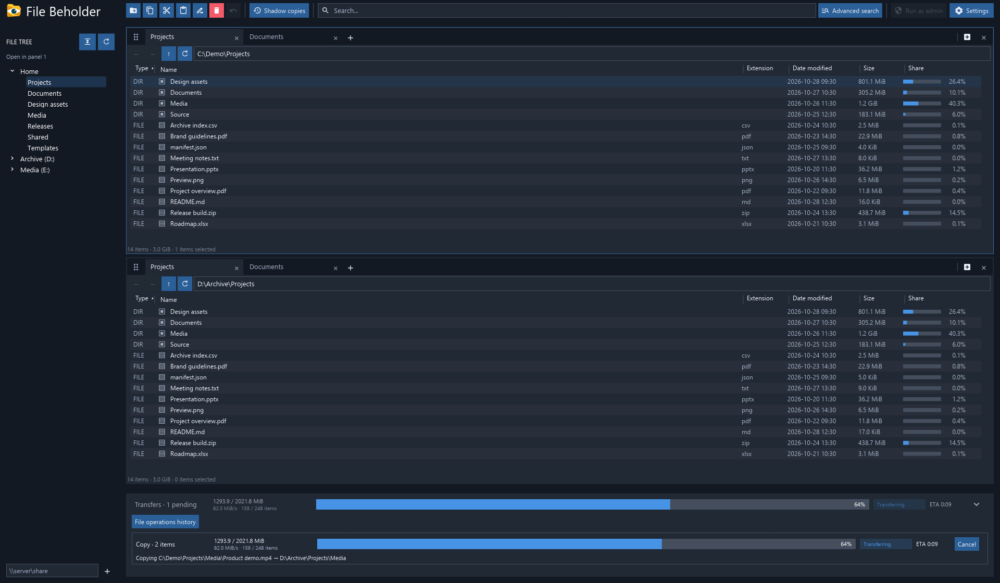

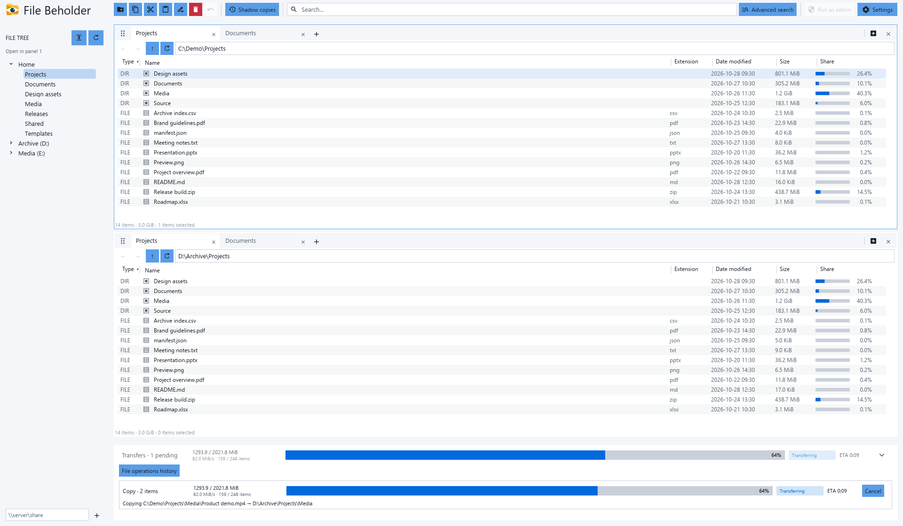

</details>

<details>
<summary>Three-panel layout</summary>

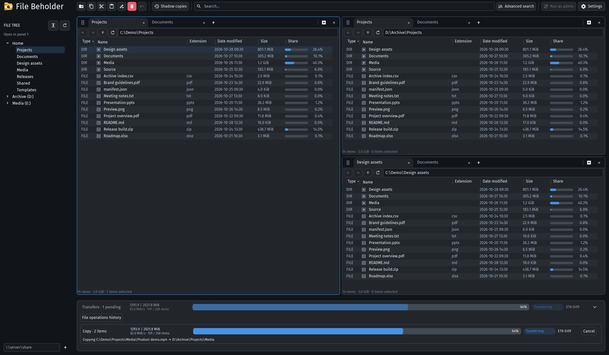

</details>

<details>
<summary>Four-panel layout</summary>

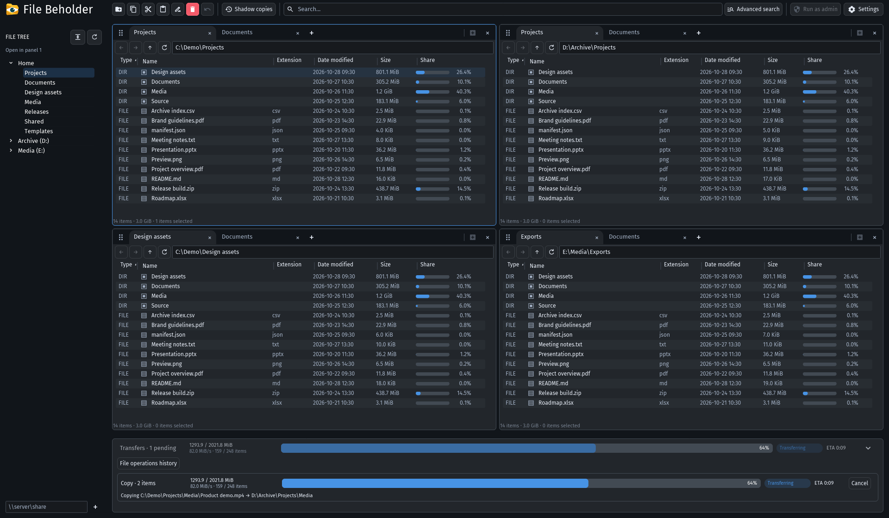

</details>

</details>

## Features

- **Fully portable:** run the executable without installation. Settings and remembered workspaces stay beside it.
- **Windows PE support:** browse drives and manage files in recovery and deployment environments.
- **Shadow copies:** browse existing Volume Shadow Copy (VSS) snapshots and copy out older versions of files.
- **Folder sizes and MFT indexing:** calculate folder totals with a shared, read-only NTFS Master File Table (MFT) index or recursive scanning. Auto mode falls back to traversal when indexing is unavailable.
- **Admin or non-admin:** run with standard user permissions, or choose Run as admin when elevated access is needed.
- **Responsive performance:** background workers, virtualized file lists, cached indexes, and batched size updates keep filesystem work off the UI thread.
- **Panels and tabs:** browse up to four panels with independent tabs. Drag tabs between panels or dock panels along an edge.
- **File trees and layouts:** use one contextual file tree or a separate tree beside each panel. Choose single, stacked, side-by-side, three-panel, four-panel, or remembered layouts.
- **Search and navigation:** search names and subfolders, or combine extension, type, size, date, and case filters in Advanced search. Paste a quoted file path and press Enter to open its containing folder.
- **Customizable columns:** sort, resize, reorder, and hide columns. Share shows each item's percentage of the displayed folder total.
- **Transfers and Undo:** queue copies, moves, and deletions with progress, speed, conflict handling, retries, and Undo.
- **Themes and personalization:** choose Default, Neumorphic, Material, or Metro styling in light, dark, or system appearance. Adjust accent color, background tint, row density, and transfer feedback.

## Build and run

Use stable Rust 1.88 or newer on Windows. MSVC builds require Visual Studio Build Tools with **Desktop development with C++** and a Windows SDK. GNU builds require MinGW-w64 and `windres` on PATH.

```powershell
cargo build --release --locked
.\target\release\file-beholder.exe
```

No installation is required. Run the executable from a local folder or USB drive, including in Windows PE. Use a writable folder to save settings and imported sounds beside it. The pinned [sk-iced](https://github.com/SkylerWallace/sk-iced) dependency is fetched by Cargo; no sibling checkout is required.

For build scripts, tests, and source packaging, see [Contributing](CONTRIBUTING.md) and [Validation](VALIDATION.md).

## Getting around

Double-click a folder to open it. Double-click a file to launch its associated application, or use **Open with** from its context menu. File opening can be disabled in Settings.

Enter a folder path in a panel's address bar to navigate. Address bars accept `%NAME%` environment variables, including `%USERPROFILE%`, `%TEMP%`, and custom variables. Search accepts file or folder paths with or without quotes; press Enter to navigate. A file path opens the containing folder.

Right-click a file or folder for Copy path, Open in terminal, Properties, and Reveal in File tree. Drag a folder onto a panel's tab bar to open a new tab. Drag files between panels to copy them; use Cut and Paste to move them.

Select **Shadow copies** in the ribbon to choose an existing drive snapshot and open it in a panel tab. Browse its folders and copy files into another panel to recover older versions.

The shared file tree follows the active panel. In a narrow window, its edge handle opens a drawer. The ribbon switches to two rows when needed, and Settings remains available.

### Keyboard shortcuts

| Action | Shortcut |
| --- | --- |
| Focus search | Ctrl+F |
| New panel / close panel | Ctrl+N / Ctrl+Shift+W |
| New tab / close tab | Ctrl+T / Ctrl+W |
| Next tab / previous tab | Ctrl+Tab / Ctrl+Shift+Tab |
| Next panel / previous panel | Tab / Shift+Tab |
| New folder | Ctrl+Shift+N |
| Rename | F2 |
| Copy / Cut / Paste | Ctrl+C / Ctrl+X / Ctrl+V |
| Copy paths | Ctrl+Shift+C |
| Select all visible items | Ctrl+A |
| Delete to Recycle Bin | Delete |
| Permanently delete | Shift+Delete |
| Undo | Ctrl+Z |
| Properties | Alt+Enter |
| Select an item | Arrow keys |
| Expand / collapse a tree folder | Right / Left arrow |
| Jump to an item by its initial | Type a letter or number |

Shortcuts follow the focused browsing surface. Text fields and dialogs use their own editing and focus behavior.

## Settings

**Appearance** controls style, light/dark/system mode, background tint, accent, density, and alternating row colors.

**Files** includes Search subfolders (on by default for name searches), the contextual/per-panel File trees dropdown, Recycle Bin confirmation, directory-size calculation, size units, and file opening. Advanced search can choose its own subfolder scope.

**Workspace & startup** selects a starting layout or restores the last workspace. Administrator on launch requests elevation when enabled; ordinary browsing does not require it.

**Transfer feedback** offers Windows notifications and Warm, Crystal, Off, or custom PCM WAV sounds. Notifications and sounds start off. **Browse…** imports a validated WAV without changing the original; **Test sound** previews up to five seconds.

**Show licenses** opens the offline licenses viewer. Filter by component name or license, then select a component to read its notices and full license text.

## Folder sizes and performance

Choose **Settings → Files → Directory sizes** to use **Auto**, **MFT**, **Recursive**, or **Off**. Auto uses NTFS indexing where available and recursive scanning for other filesystems, network paths, or unavailable indexes. MFT mode uses indexed totals only. Sizes update progressively, and navigation cancels the previous scan.

File Beholder runs as either an administrator or a standard user. **Run as admin** in the ribbon relaunches it with elevation; **Administrator on launch** saves that startup preference. Elevated access can enable raw NTFS reads for MFT indexing. Auto mode continues with ordinary traversal when those reads are unavailable.

File lists render a bounded window of visible rows. Tabs share cached NTFS indexes, size results arrive in batches, and the software renderer redraws damaged regions. These features reduce repeated work while browsing large directories. See [Scanning](SCANNING.md) for calculation details and [Scrolling performance](SCROLL_PERFORMANCE.md) for the measured workload and results.

## Transfers and Undo

Expand Transfers to see active and queued jobs, byte totals, speed, and time remaining. Drag the drawer's top edge to resize it. Conflict prompts let you decide how to handle an occupied destination. Failed or skipped items remain available for retry.

**File operations history** lists this session's actions. **View successful transfers** lists completed selected files and folders. The history view is separate from the durable Undo journal.

Copies preserve file bytes and modified timestamps. They do not preserve every filesystem attribute, alternate stream, or security descriptor. A move removes a source only after its destination copy is committed. Reparse points are skipped during directory-size scans to avoid cycles; inaccessible contents produce partial totals.

Undo checks the current file contents and refuses to overwrite an occupied original path. Permanent deletion cannot be undone. See [Transfers](TRANSFERS.md) for conflict, retry, recovery, and Undo behavior.

## Local data

| Data | Location |
| --- | --- |
| Settings | `file-beholder.ini` beside the executable |
| Remembered workspace | `file-beholder-session.json` beside the executable |
| Imported sound | `file-beholder-sound-*.wav` beside the executable |
| Undo journal and replacement backups | `%LOCALAPPDATA%/FileBeholder/history`, with a temporary-directory fallback |

The previous `file-beholder-settings.ini` filename migrates automatically. Personal settings, sessions, history, toolchains, and compiled binaries are excluded from source archives.

## Documentation

- [Scanning](SCANNING.md): logical sizes, NTFS indexing, recursive fallback, and partial totals.
- [Transfers](TRANSFERS.md): file-operation semantics, retries, and recovery.
- [Contributing](CONTRIBUTING.md): toolchains, development workflow, and source packaging.
- [Validation](VALIDATION.md): automated checks, native smoke tests, and reproducible README screenshots.
- [Changelog](CHANGELOG.md): release changes.

Windows is the supported platform. The checked-in Windows CI workflow is currently disabled; local validation is described in Validation.

## License

File Beholder application code and owned assets are [MIT](LICENSE). Third-party components retain their original licenses and notices, including the MIT license for vendored Iced source.

Dependency and font notices are embedded in the application and retained under [docs/licenses](docs/licenses/README.md). See [Third-party notices](THIRD_PARTY_NOTICES.md) for attribution and renderer provenance. Keep these licenses and notices with redistributed copies.
